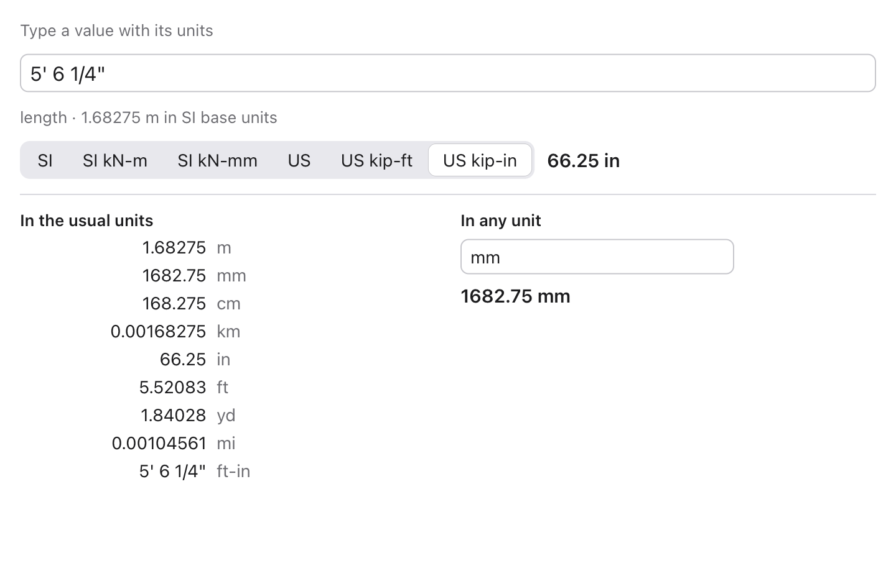

# units

Units for [Tessel](https://tessel-lang.syncster.dev) programs, made for
engineering. It knows every unit, prefix and named dimension in
[pint](https://pint.readthedocs.io), plus engineering units pint doesn't
have (psf, ksf, pcf, cfs, gpm, MGD, MCM, inH2O and others). It converts
numbers, reads what people type into a field ("5' 6 1/4\"",
"3 kN/m + 200 lbf/ft", "68 °F"), keeps quantities whose sums check their
dimensions, writes values neatly ("12.50 kN·m", 5' 6 1/4"), and switches a
whole display between unit systems (SI, kN-m, kN-mm, US, kip-ft, kip-in).



```tessel
import units

fn main() {
    // Plain numbers in, plain numbers out.
    let m = try units.convert(3.0, from: "ft", to: "m")             // 0.9144
    let gamma = try units.convert(120.0, from: "pcf", to: "kN/m³")  // 18.85
    let f = try units.convert(20.0, from: "°C", to: "°F")           // 68
    // What people type into a field, in the field's unit.
    let mm = try units.read("5' 6 1/4\"", unit: "mm")               // 1682.75
    let w = try units.read("3 kN/m + 200 lbf/ft", unit: "kN/m")     // 5.919
    // Quantities that check their dimensions.
    let span = try units.quantity(6.0, "m")
    let load = try units.quantity(12.0, "kN/m")
    let moment = span.power(2.0).times(load).scaled(1.0 / 8.0)      // w L² / 8
    print(moment.show("kN·m"))                                      // 54.00 kN·m
    print(units.feetInches(mm, unit: "mm"))                         // 5' 6 1/4"
    if let us = units.system("US kip-ft") {
        print(us.show(moment))                                      // 39.83 kip·ft
    }
}
```

## Using it

Add it to a project (Tessel 0.10 or later):

```sh
tessel add units
```

then `import units`.

## Units

A unit is one name, or several joined by `·`, `*`, `×`, a space or `/`,
with powers written `^2`, `**2`, `²` or straight after the name (`m2`):
`kN`, `kilometres`, `°F`, `kN·m`, `m^3/s`, `kg m**-3`, `W/(m·K)`.

Names are found the way pint finds them, in this order:

1. The name as it is: `min` is a minute, `cd` a candela.
2. A prefix and a name: `kft`, `kilofeet`, `µs`, `GPa`, `KiB`.
3. The same with an "s" taken off the end: `kips`, `meters`, `kilowatts`.

The first that fits wins. Some of pint's names may surprise an engineer:

| Name | Is | Not |
|---|---|---|
| `mil` | 1/64,000 of a turn (an angle) | a thousandth of an inch: that's `thou` |
| `C`, `F` | coulomb, farad | °C, °F: write `°C`, `degC`, `°F`, `degF` |
| `h` | hour | Planck's constant (`planck_constant`) |
| `ton` | short ton (2000 lb) | tonne: that's `t` or `tonne` |
| `gal` | US gallon | imperial gallon: `imperial_gallon` |
| `da` | deciyear (`d` + `a`) | |
| `G` | gauss | |

What units adds to pint:

- **An angle is a dimension** of its own, as is a bit of information. So
  `rpm` converts to `rad/s` and `deg/s` but not to `Hz` (in pint it does,
  with a hidden 2π).
- **Engineering units:** `psf`, `ksf`, `tsf`, `pcf`, `kcf`, `pci`, `plf`,
  `klf`, `cfs` (`cusec`), `cms` (`cumec`), `lps`, `lpm`, `gpm`, `gpd`, `MGD`,
  `MCM` (million m³), `ha_m`, `ac_ft`, `inH2O`, `meter_H2O`, `fpm`, `var`,
  `ppb`, `dozen`, and `'` and `"` for feet and inches. `pcf`, `kcf` and `pci`
  are unit weights (pound-force per cubic foot), as soil and concrete are
  given: 120 pcf is 18.85 kN/m³.
- **Temperatures** convert with their zeros: 20 °C is 68 °F. Among other
  units, °C is a difference, as in pint: `W/(m·°C)` is `W/(m·K)`.
- **Log units** (`dB`, `dBm`, `dBW`, `Np`, `octave`) convert with their
  scales, on their own: 10 dBm is 10 mW.

| Function | Gives |
|---|---|
| `unit(text)` | A `Unit`: its `factor` to SI base units, `dims` (powers of length, mass, time, temperature, angle, current, substance, luminosity, information and printing units), `offset`, `logBase`, `logFactor`, and `toSI(x)`, `fromSI(v)`, `isOffset()`, `isLog()`, `isDimensionless()`. |
| `isUnit(text)` | Whether the text is a unit. |
| `info(name)` | A table unit's `name`, `symbol`, all its `names`, `factor`, `offset` and `dimension`, or nil. |
| `allUnits()` | The names of the 440 units in the table (with prefixes, many more read). |

## Converting

| Function | Gives |
|---|---|
| `convert(x, from:, to:)` | x in another unit: `convert(3, from: "ft", to: "m")` is 0.9144. |
| `factor(from:, to:)` | What to multiply by: `factor(from: "kip", to: "kN")` is 4.448. Not for °C, °F or dB. |
| `toSI(x, unit)`, `fromSI(v, unit)` | A value in SI base units, and back. |

Each returns a `Result`, which fails with a reason: an unknown unit
("\"frob\" isn't a unit"), or units that measure different things ("can't
convert rpm (an angular velocity) to Hz (a frequency)").

## Reading what's typed

`read(text, unit:)` reads a number field, giving the value in the field's
unit:

| Typed | In a field in | Gives |
|---|---|---|
| `2*3.5 + 1` | anything | 8 |
| `3 ft` | mm | 914.4 |
| `5'6"`, `5' 6"`, `5 ft 6 in` | in | 66 |
| `5' 6 1/4"` | in | 66.25 |
| `1/4 in`, `3/8"` | in | 0.25, 0.375 |
| `1 m + 50` | mm | 1050 (a plain number is in the field's unit) |
| `10 kN / 2 m` | kN/m | 5 |
| `3 kN/m + 200 lbf/ft` | kN/m | 5.919 |
| `68 °F`, `-40 °C` | °C | 20, −40 |
| `10 dBm` | mW | 10 |
| `sqrt(16 m²)` | m | 4 |
| `asin(0.5)` | deg | 30 |
| `50 %` | (none) | 0.5 |

Functions: `sqrt abs round sin cos tan asin acos atan ln log exp` and
`pi`. `sin`, `cos` and `tan` take degrees when given a plain number, as in
CAD programs. A failure says what's wrong: "mm is a length, not a mass",
"can't add a length and a time", "a ( isn't closed".

`readQuantity(text)` reads the same text into a `Quantity`.

## Quantities

A `Quantity` keeps its `value` in SI base units (a temperature in
kelvins), with its `dims`. Make one with `quantity(x, unit)` or
`readQuantity(text)`.

| Method | Gives |
|---|---|
| `to(unit)` | The value in a unit, if it measures the same thing. |
| `plus(q)`, `minus(q)` | The sum and difference, if both measure the same thing (a `Result`). |
| `times(q)`, `over(q)` | The product and quotient: a force over an area is a pressure. |
| `scaled(k)`, `power(p)`, `squareRoot()` | Times a number, to a power, the square root. |
| `dimension()` | What it measures: "length", "pressure", or its SI unit. |
| `sameDimension(q)`, `isDimensionless()` | |
| `show(unit, decimals:, sig:, trim:)` | Text in a unit: "54.00 kN·m". |

## Writing values

| Function | Gives |
|---|---|
| `format(x, unit, decimals:, sig:, trim:)` | `format(12.5, "kN*m")` is "12.50 kN·m"; `sig: 3` gives three significant figures; `trim` drops zeros at the end. |
| `pretty(unit)` | A unit written neatly: "kg m**-3" is "kg·m⁻³". |
| `autoPrefix(x, unit, …)` | The SI prefix that puts the number between 1 and 1000: 0.0012 m is "1.20 mm", 25000 N is "25.00 kN". |
| `feetInches(x, unit:, denominator:)` | A length in feet and inches, to the nearest 1/16 inch: "5' 6 1/4\"". `read` reads it back. |
| `formatNumber(x, decimals:)` | A number with no zeros at the end: 2.5, 300. |

## Dimensions

| Function | Gives |
|---|---|
| `dimension(unit)` | What a unit measures: "length", "pressure", "unit_weight", "force_per_length", "angular_velocity". |
| `dimensionNames(unit)` | Every name: kN·m is energy, moment, torque. |
| `dimensionOf(name)` | A named dimension's powers ("unit weight" works too). |
| `dimensionsList()` | All the names: pint's 69 and the engineering ones. |
| `siUnit(dims)` | The SI unit of a dimension: "kg·m⁻¹·s⁻²". |
| `sameDimension(a, b)` | Whether two units convert to each other. |
| `unitsFor(dimension)` | Every unit of a dimension (by name, or by a unit of it). |
| `commonUnits(dimension)` | The usual few, for a unit picker: "pressure" gives Pa, kPa, MPa, GPa, bar, atm, mmHg, psi, ksi, psf, ksf, inHg, ftH2O. |

## Unit systems

`system(name)` gives one of six `UnitSystem`s:

| Name | Lengths | Forces | Pressures | Moments | Unit weights |
|---|---|---|---|---|---|
| `SI` | m | N | Pa | N·m | N/m³ |
| `SI kN-m` | m | kN | kPa | kN·m | kN/m³ |
| `SI kN-mm` | mm | kN | MPa | kN·m | kN/m³ |
| `US` | ft | lbf | psi | lbf·ft | pcf |
| `US kip-ft` | ft | kip | ksf | kip·ft | kcf |
| `US kip-in` | in | kip | ksi | kip·in | kip/in³ |

A system is a list of units: for a dimension, the first unit in `units`
that measures it wins. `unitFor(dims)`, `unitForUnit("kN")` and
`unitForDimension("stress")` give that unit; `convert(x, from:)` converts a
value into it; `show(q)` and `showValue(x, unit)` write it. Make your own
with `UnitSystem(name:, units:)`, or change a built-in one's `units`.

## Tests

```sh
tessel run tests
TESSEL=tessel sh tests/ui.sh
```

The first checks the library against 14,229 cases with pint's answers
(34,427 checks): every name in the table, 2,500 random prefixed and plural
names, 700 random strings that may or may not be names, 2,500 compound
units written in different ways, 3,700 conversions (temperatures and dB
among them), 2,350 typed sums and products, and 1,500 sums, products and
powers of quantities. The cases come from `python3 tools/oracle/oracle.py`,
which needs pint. It then checks by hand: feet and inches, fractions, the
rules for plain numbers, every message, formatting, dimensions and systems.
The second drives the example app headless (15 checks).

## Making the table

`table.tsl` is written by `python3 tools/gen/gen.py` from pint's registry
(pint 0.24.4), with the changes in `tools/gen/registry.py`. Run it again,
and then the oracle, to follow a new pint.

## What's where

| File | |
|---|---|
| `registry.tsl` | `Unit`, and finding a unit by name, prefix and plural. |
| `parse.tsl` | Reading units and values: `unit`, `isUnit`, `read`. |
| `quantity.tsl` | `convert`, `factor`, `toSI`, `fromSI`, `Quantity`, `quantity`, `readQuantity`. |
| `format.tsl` | `format`, `pretty`, `autoPrefix`, `feetInches`, `formatNumber`. |
| `dimensions.tsl` | Dimension names, `siUnit`, `unitsFor`, `commonUnits`, `info`. |
| `systems.tsl` | `UnitSystem`, `system`, `systemNames`. |
| `table.tsl` | Every unit, prefix and dimension (generated). |
| `examples/main.tsl` | A converter to try it on: `tessel run examples`. |
| `tests/` | The tests and pint's cases. |
| `tools/gen/`, `tools/oracle/` | Make the table and the cases. |

## Licence

MIT: see [LICENSE](LICENSE). The unit definitions in `table.tsl` come
from pint, under its BSD licence: see [LICENSE-pint](LICENSE-pint).
